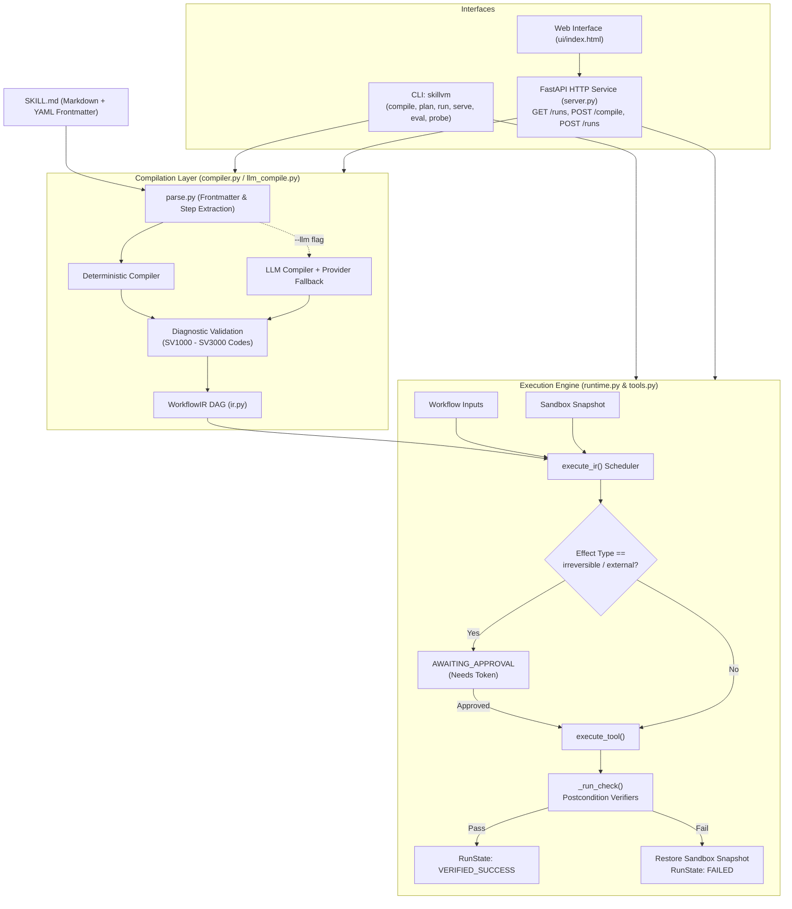

# SkillVM

[](pyproject.toml)
[](pyproject.toml)
[](LICENSE)

A compiler and deterministic runtime that turns natural-language agent skills (`SKILL.md`) into typed, verified workflows.

---

## Overview

Natural-language agent skills (such as instructions in `SKILL.md` files) are typically executed by sending raw text to an LLM loop. This approach suffers from **false-success states**: the model reports that a task succeeded even when outputs are missing, malformed, or unverified.

**SkillVM** addresses this problem by treating skills as code:

1. **Compiles** natural-language skill definitions into a typed Intermediate Representation (Workflow IR) Directed Acyclic Graph (DAG).
2. **Enforces permissions and effect boundaries** at compile time and runtime.
3. **Executes** workflows inside an isolated workspace sandbox with automatic snapshotting and rollback on failure.
4. **Verifies postconditions deterministically** using independent verifier checks rather than LLM self-evaluation.

---

## Key Results

SkillVM includes an automated evaluation harness (`skillvm eval`) that tests compiled execution against baseline execution across the test corpus.

### Current 15-Skill Benchmark (`eval/results.json`)

Evaluated across all 15 skills in `eval/corpus/` ($N=15$ independent tasks with ground-truth verification):

| Arm | Task Success Rate | False Success Rate | Verified Success Rate | Error Rate | Mean Duration |
| :--- | :---: | :---: | :---: | :---: | :---: |
| **SkillVM** | **26.7%** (0.27) | **0.0%** (0.00) | **13.3%** (0.13) | 6.7% (0.07)* | ~4.87 ms |
| **Baseline (Deterministic Parser)** | 13.3% (0.13) | **73.3%** (0.73) | 0.0% (0.00) | 0.0% (0.00) | ~0.52 ms |

*\*The single error in SkillVM was the intended compile-time rejection of `02-malformed`.*

- **Zero False-Successes**: Compiling skills into typed IR with runtime postcondition verification completely eliminated false-success outcomes (**0.0%** vs **73.3%**). Every adversarial or failing task (malformed specifications, missing permissions, invalid schemas, missing source files, corrupted JSON, and path traversal attempts) was caught and reported as failed rather than falsely claiming completion.
- **Baseline Arm Clarification**: The offline baseline is a deterministic step parser reusing SkillVM helpers without IR compilation or postcondition verification. It is **not** an LLM agent.
- **Real LLM Baseline**: A genuine multi-turn raw-skill LLM tool-use loop (`run_llm_baseline_arm`) is implemented in `eval.py` and can be executed via `skillvm eval --live`. When provider credentials are not configured, the live LLM baseline is accurately reported as unexecuted (`llm_baseline_executed: false`).

### Historical Reference Run (`eval/historical_results.json`)

Preserved provenance from initial 4-skill evaluation ($N=4, n=2$ per skill, 8 evaluations per arm):

| Arm | Task Success Rate | False Success Rate | Verified Success Rate | Error Rate | Mean Duration |
| :--- | :---: | :---: | :---: | :---: | :---: |
| **SkillVM (Historical)** | **75.0%** (0.75) | **0.0%** (0.00) | **50.0%** (0.50) | 25.0% (0.25) | ~1.69 ms |
| **Baseline (Historical)** | 50.0% (0.50) | **25.0%** (0.25) | 0.0% (0.00) | 0.0% (0.00) | ~2.27 ms |


---

## Features

- **Deterministic & LLM Compilation**:
  - Deterministic compiler with AST step parser, keyword inferrer, type checker, and cycle detector.
  - Optional model-assisted compilation (`--llm`) supporting Google Gemini, OpenRouter, and local LM Studio with automated fallback and single-pass repair.
- **Workflow IR DAG**:
  - Typed graph schema with node discrimination: `input`, `tool`, `transform`, `llm`, `condition`, `approval`, `verify`, `output`.
  - Effect classification: `read`, `reversible_write`, `irreversible`, and `external`.
- **Sandboxed Execution Runtime**:
  - Directory-level workspace sandbox with path traversal and symlink escape defenses.
  - Pre-execution snapshot capture and automatic restoration on execution failure.
  - Server-side permission enforcement checking tool permissions against granted privileges.
  - Idempotency key tracking to prevent duplicate executions.
- **Deterministic Postcondition Verification**:
  - Built-in verifiers: `file_exists`, `file_contains_fields`, `json_matches_schema`, `checksum_equals`, `schema_unchanged`.
  - Rejection of vacuous/trivial postconditions (`always_true`, `pass`, `noop`).
- **Human-in-the-Loop Approval**:
  - Irreversible actions (`irreversible`, `external`) require human approval tokens before node execution.
- **Local Web Service & Visual UI**:
  - Built-in FastAPI application with Swagger OpenAPI docs (`/docs`).
  - Standalone single-page web UI for interactive skill compilation, DAG inspection, workflow execution, and node approval.
- **Secret Redaction**:
  - Automated masking of API keys and bearer tokens from logs, error dumps, and prompt excerpts.

---

## Architecture



---

## Tech Stack

<div align="center">

[](https://www.python.org/)
[](https://fastapi.tiangolo.com/)
[](https://docs.pydantic.dev/)
[](https://typer.tiangolo.com/)
[](https://ai.google.dev/)
[](https://openai.com/)
[](https://www.uvicorn.org/)
[](https://docs.pytest.org/)

</div>

| Category | Component | Verified Version | Purpose |
|:---|:---|:---:|:---|
| **Language** |  | `>=3.11` | Core language runtime |
| **Data Validation** |  | `>=2.6` | Workflow IR schemas and runtime models |
| **CLI Framework** |  | `>=0.12` | Command-line interface definitions |
| **Web Framework** |  | `>=0.115` | REST API service and UI mounting |
| **ASGI Server** |  | `>=0.30` | Web server runner |
| **LLM Clients** |  `google-genai` | `>=1.0` | Google Gemini native API integration |
| |  `openai` | `>=1.40` | OpenRouter and LM Studio client |
| |  | `>=0.27` | HTTP transport client |
| **Configuration** |  `python-dotenv` | `>=1.0` | `.env` file loader |
| **Serialization** |  `PyYAML` | `>=6.0` | Frontmatter parsing |
| **Testing** |  | `>=8.0` | Test runner and assertions |
| **Knowledge Graph** |  `graphifyy` | `>=0.9.90` | AST codebase knowledge graph extraction |

---

## Prerequisites

1. **Python**: Version 3.11 or later.
2. **LLM Credentials (Optional)**:
   - For Google Gemini: `GEMINI_API_KEY` and `GEMINI_MODEL`.
   - For OpenRouter: `OPENROUTER_API_KEY` and `OPENROUTER_MODEL`.
   - For Local Inference: [LM Studio](https://lmstudio.ai/) running locally on `http://localhost:1234/v1` (`LMSTUDIO_MODEL`).
     *Note: Neither remote credentials nor local LLM engines are required for deterministic compilation and sandboxed execution.*

---

## Installation

1. **Clone the repository:**

   ```bash
   git clone https://github.com/Omiiii04/MLH-VU.git
   cd MLH-VU
   ```
2. **Create and activate a virtual environment:**

   - **Linux / macOS:**
     ```bash
     python3 -m venv .venv
     source .venv/bin/activate
     ```
   - **Windows (PowerShell):**
     ```powershell
     python -m venv .venv
     .venv\Scripts\Activate.ps1
     ```
3. **Install the package and development dependencies:**

   ```bash
   pip install -e ".[dev]"
   ```
4. **Initialize configuration:**

   - **Linux / macOS:**
     ```bash
     cp .env.example .env
     ```
   - **Windows (PowerShell):**
     ```powershell
     Copy-Item .env.example .env
     ```

---

## Configuration

Configuration values are defined in `src/skillvm/config.py` and read from the environment or `.env` file via `python-dotenv`:

| Variable                         |  Required  | Description                                                                           | Default                                         |
| :------------------------------- | :---------: | :------------------------------------------------------------------------------------ | :---------------------------------------------- |
| `LLM_PROVIDER_ORDER`           |     No     | Comma-delimited priority list of providers (`google`, `openrouter`, `lmstudio`) | `google,openrouter,lmstudio`                  |
| `LLM_FALLBACK_ENABLED`         |     No     | Enable automatic failover to the next provider on failure                             | `true`                                        |
| `LLM_LOCAL_ONLY`               |     No     | When set to `true`, disables external network calls to remote LLMs                  | `false`                                       |
| `GEMINI_API_KEY`               | Conditional | API key for Google Gemini native API (required if using `google` provider)          | `""`                                          |
| `GEMINI_MODEL`                 | Conditional | Model ID for Google Gemini (e.g., `gemma-4-26b-a4b-it`)                             | `""`                                          |
| `OPENROUTER_API_KEY`           | Conditional | API key for OpenRouter API (required if using `openrouter` provider)                | `""`                                          |
| `OPENROUTER_BASE_URL`          |     No     | OpenRouter API base endpoint                                                          | `https://openrouter.ai/api/v1`                |
| `OPENROUTER_MODEL`             | Conditional | Model ID for OpenRouter                                                               | `""` (Example: `google/gemma-4-26b-a4b-it`) |
| `LMSTUDIO_BASE_URL`            |     No     | Base endpoint for running LM Studio server                                            | `http://localhost:1234/v1`                    |
| `LMSTUDIO_MODEL`               | Conditional | Model identifier reported by LM Studio                                                | `""`                                          |
| `LLM_REQUEST_TIMEOUT_SECONDS`  |     No     | Per-request timeout in seconds for LLM calls                                          | `60`                                          |
| `LLM_MAX_RETRIES_PER_PROVIDER` |     No     | Maximum retries before triggering provider failover                                   | `1`                                           |
| `LLM_MAX_FALLBACK_ATTEMPTS`    |     No     | Maximum provider transitions allowed per request                                      | `3`                                           |
| `LLM_OVERALL_DEADLINE_SECONDS` |     No     | Cumulative deadline across all providers for an operation                             | `120`                                         |
| `LLM_TEMPERATURE`              |     No     | Generation temperature for LLM providers                                              | `0`                                           |
| `SKILLVM_DATA_DIR`             |     No     | Directory for local runtime data storage                                              | `.skillvm`                                    |
| `SKILLVM_BIND`                 |     No     | Host IP address for the FastAPI server                                                | `127.0.0.1`                                   |
| `SKILLVM_PORT`                 |     No     | Port number for the FastAPI server                                                    | `8477`                                        |

---

## Skill Format Specification

Skills are written as Markdown documents with YAML frontmatter bounded by `---`:

```markdown
---
id: copy-and-validate
inputs:
  - name: source_path
    type: string
  - name: dest_path
    type: string
permissions:
  - fs.read
  - fs.write
  - json.parse
  - verify.run
postconditions:
  - kind: file_exists
    path: "{dest_path}"
  - kind: json_matches_schema
    path: "{dest_path}"
    schema:
      type: object
      required: [status]
effect_overrides:
  fs.write: reversible_write
---

# Copy and Validate JSON

## Steps
1. Read `source_path` with fs.read
2. Parse the file with json.parse
3. Write the object to `dest_path` with fs.write
```

### Supported Frontmatter Properties

- `id` *(string, required)*: Unique identifier for the skill.
- `inputs` *(list)*: Declared input fields with `name` and `type` (`string`, `number`, `boolean`).
- `permissions` *(list)*: Allowed operations (`fs.read`, `fs.write`, `json.parse`, `data.transform`, `verify.run`).
- `postconditions` *(list)*: Target validation criteria.
  - **Supported kinds**:
    - `file_exists`: Verifies output file presence on the filesystem.
    - `file_contains_fields`: Validates required top-level JSON fields.
    - `json_matches_schema`: Full JSON Schema validation engine supporting nested types, array items and count constraints, string min/max length and regex patterns, numeric ranges, required properties, combinators (`allOf`, `anyOf`, `oneOf`, `not`), and malformed schema rejection.
    - `checksum_equals`: Validates SHA-256 content hashes.
    - `schema_unchanged`: Verifies dictionary keys remain consistent across data transforms.
    - `row_count_delta`: Genuine SQLite relational database check (`db_path`, `table`, `delta`, or `expected_count`); explicitly fails if database configuration is missing or unsupported (no unconditional passes).
  - **Vacuous checkers rejected by compiler**: `always_true`, `true`, `pass`, `noop`.
- `effect_overrides` *(map)*: Override default tool effects (`read`, `reversible_write`, `irreversible`, `external`).

---

## Usage

### Command-Line Interface (CLI)

The package installs the `skillvm` executable.

#### 1. Compile a Skill to Workflow IR

```bash
skillvm compile eval/corpus/01-copy-json/skill.md --out ir.json
```

*Options:*

- `--out`, `-o`: Save compiled IR JSON to a specified path.
- `--verbose`, `-v`: Output the compiled IR JSON to stdout.
- `--llm`: Use model-assisted compilation with configured LLM providers instead of the deterministic compiler.

#### 2. Inspect the Execution Plan

```bash
skillvm plan ir.json
```

Prints the sequence of graph nodes, node types, dependencies, and declared effects.

#### 3. Execute a Workflow

```bash
skillvm run ir.json --workspace ./ws --inputs '{"source_path": "input.json", "dest_path": "output.json"}'
```

*Options:*

- `--workspace`, `-w`: Path to the execution workspace root (must resolve within an authorized root).
- `--inputs`, `-i`: JSON string containing input parameters (default: `{}`).
- `--approve-all`: Convenience flag for offline CLI testing that approves all approval nodes. *(Note: `approve_all=true` is rejected by the production HTTP API).*

#### 4. Safe Human-in-the-Loop Approval & Resumption

When an execution reaches a node requiring approval (`irreversible` or `external` effect), the runtime transitions to `NEEDS_APPROVAL` and generates a cryptographically unguessable 32-byte approval token (`secrets.token_urlsafe(32)`).

The runtime safely persists the run's IR, inputs, workspace, and completed side effects. Resuming execution using the token resumes the workflow without re-executing completed side effects:

```bash
# In the CLI:
skillvm approve <run_id> <node_id>

# Via HTTP API (POST /runs/{run_id}/approve):
curl -X POST http://127.0.0.1:8477/runs/<run_id>/approve \
  -H "Content-Type: application/json" \
  -d '{"node_id": "<node_id>", "token": "<token>"}'
```

#### 5. Probe Configured Providers

Verify connectivity, model listings, and supported features across configured providers:

```bash
skillvm probe
# Or probe a specific provider:
skillvm probe --provider lmstudio
```

#### 6. Run the Evaluation Harness

Run benchmark evaluations comparing the SkillVM compiled arm against the baseline prompt arms across the corpus:

```bash
# Deterministic offline evaluation (SkillVM arm vs deterministic step parser baseline)
skillvm eval --corpus eval/corpus --n 1 --out eval/results.json

# Live evaluation with real LLM tool-use baseline (requires configured LLM credentials)
skillvm eval --corpus eval/corpus --n 1 --out eval/results.json --live
```


---

### Web Service and UI

SkillVM provides an embedded FastAPI web service and single-page interactive UI.

Start the service:

```bash
skillvm serve
```

*Options:*

- `--host`, `-h`: Override bind host (default: `SKILLVM_BIND` or `127.0.0.1`).
- `--port`, `-p`: Override port (default: `SKILLVM_PORT` or `8477`).
- `--reload`: Enable hot-reload for server development.
- `--open` / `--no-open`: Automatically open the web browser on launch (default: open).

Access points:

- **Interactive UI**: `http://127.0.0.1:8477/`
- **Swagger API Documentation**: `http://127.0.0.1:8477/docs`

---

### HTTP API Reference

The server exposes the following JSON endpoints:

| Method   | Endpoint                   | Description                               | Request Body                                                               |
| :------- | :------------------------- | :---------------------------------------- | :------------------------------------------------------------------------- |
| `GET`  | `/health`                | Check service health and version          | None                                                                       |
| `POST` | `/compile`               | Compile skill markdown to IR              | `{"source": "<SKILL.MD TEXT>", "llm": false}`                            |
| `POST` | `/runs`                  | Submit a workflow for sandboxed execution | `{"ir": {...}, "inputs": {...}, "workspace": "sub_ws"}`                   |
| `GET`  | `/runs/{run_id}`         | Poll execution status and node states     | None                                                                       |
| `POST` | `/runs/{run_id}/approve` | Resume a paused run using unguessable token | `{"node_id": "<NODE_ID>", "token": "<TOKEN>"}`                            |

*API Security Controls:*
- `POST /runs` requires `workspace` to be a strict descendant of `SKILLVM_WORKSPACE_ROOT`. Root itself (`.`), empty strings, directory traversal (`..`), symlinks resolving to root, and absolute paths are rejected with HTTP 400.
- `POST /runs` rejects `approve_all=true` with HTTP 400 as an unsafe production authorization mechanism.
- `POST /runs/{run_id}/approve` verifies the unguessable 32-byte cryptographic token and resumes the workflow without re-executing previously completed side effects.

---

### Knowledge Graph Navigation

The repository contains an AST-derived knowledge graph generated by [Graphify](https://github.com/Graphify-Labs/graphify):

```bash
# Query the codebase architecture
graphify query "how does the compiler work?"

# Explain a symbol or trace connections
graphify explain "compile_skill"
graphify path "Sandbox" "compile_skill"
```

Interactive visualizations are available under `graphify-out/`:

- `graphify-out/graph.html`: Force-directed 2D graph viewer.
- `graphify-out/GRAPH_TREE.html`: Collapsible module hierarchy.
- `graphify-out/wiki/index.md`: Navigable Markdown architecture wiki.

---

## Project Structure

```text
.
├── eval/                     # Evaluation harness corpus and benchmarking data
│   ├── corpus/               # 15 reference skills with fixtures and ground-truth checkers
│   ├── results.json          # Benchmark output comparing SkillVM vs Baseline (15 skills)
│   └── historical_results.json # Preserved historical initial benchmark (4 skills)
├── graphify-out/             # Knowledge graph files, architecture wiki, and visual trees
├── src/
│   └── skillvm/              # Core application package
│       ├── cli.py            # Typer CLI application commands
│       ├── compiler.py       # Deterministic compiler and diagnostic validator
│       ├── config.py         # Dataclass settings loader from environment variables
│       ├── diag.py           # Diagnostic codes (SV1000-SV3000) and severity enums
│       ├── eval.py           # Evaluation runner for skillvm vs baseline arms
│       ├── ir.py             # Pydantic schemas for WorkflowIR and graph nodes
│       ├── llm_compile.py    # LLM-assisted compiler with repair and validation loops
│       ├── parse.py          # Markdown step parser and YAML frontmatter extractor
│       ├── providers.py      # Gemini, OpenRouter, LM Studio, and Fake provider layer
│       ├── redact.py         # Secret redaction utility for credentials and tokens
│       ├── registry.py       # Tool specifications, schemas, and effect metadata
│       ├── runtime.py        # Directed graph execution engine and state machine
│       ├── server.py         # FastAPI REST service and static UI mounting
│       ├── tools.py          # Workspace sandbox and deterministic verifiers
│       └── ui/               # Single-Page web UI static assets (HTML/CSS/JS)
├── tests/                    # Unit, security, provider, server, and live test suites
├── LICENSE                   # Apache 2.0 legal license text
└── pyproject.toml            # Build configuration, entrypoints, and dependencies
```

---

## Security and Sandboxing

| Threat Vector                      | Mitigation Strategy                                                                | Implementation                           |
| :--------------------------------- | :--------------------------------------------------------------------------------- | :--------------------------------------- |
| **Path Traversal**           | Path resolution verified with `relative_to(workspace)` and strict descendant checks | `Sandbox._safe_path()` in `tools.py` |
| **Symlink Escape**           | Canonical path resolution validates each segment remains within sandbox            | `Sandbox._safe_path()` in `tools.py` |
| **Workspace Root Escape**    | Rejects workspaces resolving to root itself, empty strings, traversal, or drive absolute paths | `_resolve_workspace()` in `server.py` |
| **Unauthorized Tool Calls**  | Tool invocation strictly validates against granted skill permissions               | `_check_permission()` in `tools.py`  |
| **Malformed IR / Injection** | Pydantic schema validation rejects unsupported types, cycles, and invalid bindings | `_validate_ir()` in `compiler.py`    |
| **Unapproved Side Effects**  | Actions marked `irreversible` or `external` require explicit token approval        | `ApprovalNode` gate in `runtime.py`  |
| **Snapshot Collisions**      | Isolated per-run snapshots (`.snapshot_<ws>_<run_id>`) prevent concurrent run clobbering | `Sandbox` in `tools.py` |
| **Duplicate / Replay Runs**  | Unique idempotency keys are tracked in a global execution registry                 | `_RUN_REGISTRY` in `runtime.py`      |
| **Secret / Key Leakage**     | Regular expression masking strips API keys and auth headers from logs and errors   | `redact.py`                            |

> **Rollback Guarantees and Boundary Notice**:
> - **Reversible Filesystem Boundary**: Workspace restoration restores files modified within the declared workspace directory using per-run isolated snapshots (`.snapshot_<ws>_<run_id>`). Snapshot failures are explicitly reported as errors rather than silently continuing with false rollback expectations.
> - **Irreversible / External Effects**: External side effects (such as out-of-tree files, external relational database mutations, or external HTTP requests) cannot be rolled back by workspace restoration.

---

## Testing

SkillVM includes 111 tests across 9 test modules:
- `test_compiler.py`: Deterministic parsing, diagnostic codes, and type validation.
- `test_eval.py`: Evaluation harness, workspace isolation cleanup, LLM baseline tool loop, and ground truth integrity.
- `test_live.py`: Live provider integration smoke tests (Gemini, OpenRouter, LM Studio).
- `test_llm_compile.py`: Model-assisted compilation, repair passes, and fallback chains.
- `test_providers.py`: Provider manager fallback disabling, retry limits, deadlines, auth error handling, and Gemini SDK transport timeout enforcement.
- `test_runtime.py`: Workflow DAG execution, snapshot isolation, SQLite `row_count_delta`, and full JSON schema verification.
- `test_security.py`: Workspace isolation (rejecting `.`, empty, traversal, symlink escapes, drive paths), unauthorized tool denial, and secret redaction.
- `test_server.py`: FastAPI endpoints, `approve_all=true` rejection, and safe approval resumption API.

Run the test suite:

```bash
pytest tests/ -v
```

*Actual Suite Results:*
- **108 passed, 3 skipped** (symlink tests on Windows requiring elevated OS symlink privileges).
- Offline tests run deterministically with zero mock leaks.

---

## Known Limitations

- **External Effect Rollback**: As noted in the security model, external side effects outside the workspace sandbox directory (e.g. external network APIs) cannot be rolled back by filesystem snapshots.
- **Process Lifetime for Approval Resumption**: Paused run state is persisted in memory in `_RUN_REGISTRY` during the server process lifetime; restarting the server process clears active pending approval tokens.
- **Network Verifier in Local Mode**: The `http_status` postcondition checker is disabled when running in local-only mode (`tools.py`).
- **Single-Host Binding**: The web service binds to `127.0.0.1` by default and does not include multi-tenant user authentication (`server.py`).


---

## License

This project is licensed under the [Apache License, Version 2.0](LICENSE).
